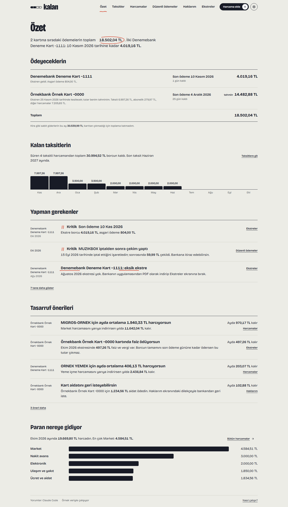
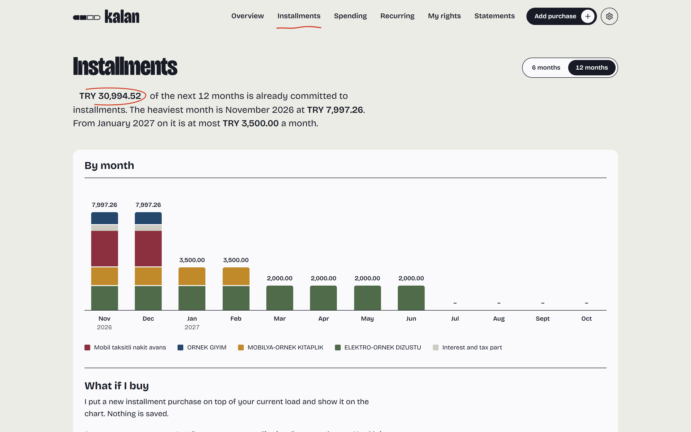

# kalan

**Know what your credit cards will take from you, month by month.**

kalan is a free, open source desktop app that reads your credit card statement PDFs and shows, in plain words:

1. how much you pay on each card this month, and by when,
2. how much installment (taksit) debt is left and when it ends,
3. where your money goes, and where you can save.

It runs on your own computer. There is no account, no server and no subscription. If you already use an AI tool such as
Claude Code, Codex, Gemini CLI or Antigravity, kalan can use it to sort your spending into categories and suggest savings.
It works without one too.



## Download

Get the Windows installer from the [latest release](https://github.com/Keremavsr/kalan-front/releases/latest).
The app is not code-signed yet, so Windows SmartScreen asks once before it starts (More info, then Run anyway).
macOS and Linux builds are configured but not published yet.

## What it does

- **Reads statements by itself.** Drop a PDF; kalan reads every row and checks its sum against the totals printed on the
  statement. Garanti BBVA Bonus, Yapı Kredi World and VakıfBank Worldcard are supported today; other banks can be added
  with a short template file, no code ([how](https://github.com/Keremavsr/kalan-back/blob/main/docs/adding-a-bank.md)).
- **Installments first.** Every plan, what is paid, what is left, the month each one ends. "What if I buy this in
  6 installments?" shows the new load on top of the current one before you buy.
- **Subscriptions and bills apart.** Fixed-price subscriptions, bills that change every month, and places you simply
  visit often are listed separately; price rises and charges after you cancelled are flagged.
- **Your rights.** Turkish card rules are built in: a letter to ask for the annual card fee back, and the minimum
  payment and interest at the legal rates.
- **Four languages:** Turkish, English, Spanish, Portuguese.

| | |
| --- | --- |
|  |  |

## Privacy

Statements are read on your computer. kalan removes your card number, name, address and similar details before anything
is stored, and keeps the data in one file in your user folder. If you connect an AI tool, the transactions it sorts
(date, description, amount) are sent to that tool, and kalan tells you so in the app. The full rules are in the
[back end README](https://github.com/Keremavsr/kalan-back#privacy).

## How it is built

This repository is the app: the interface (Vite, React, TypeScript) and the desktop shell (Electron). The engine that
reads statements and does every calculation is [kalan-back](https://github.com/Keremavsr/kalan-back) (Python); the
two talk over HTTP on `127.0.0.1` only. The installer bundles both.

## Development

### Run

```sh
npm ci
npm run dev:mock   # demo data, no back end needed
npm run dev        # talks to VITE_KALAN_API (default http://127.0.0.1:8765)
```

Demo data is invented (card 0000, merchants such as MIGROS-ORNEK and STREAMFLIX). In mock mode,
uploading any PDF "reads" the October statement, which has a deliberate reconciliation mismatch;
a second upload returns `409 duplicate`, a file named `bilinmeyen.pdf` returns `422 unknown_format`.

### Desktop app (Electron)

The desktop app is the same front end in an Electron window. On start it launches the back end as a
child process on 127.0.0.1 and passes its URL to the page as `window.kalan.apiBase`. No cloud server.

```sh
npm run desktop:dev        # Vite + Electron; starts `kalan serve --port 0 --print-port` from PATH
npm run desktop:dev:mock   # same with demo data, no back end
npm run desktop:build      # Windows NSIS installer (unsigned) in release/
```

- Back end command in development: `kalan` from PATH, or `KALAN_BACK_CMD`
  (for example `KALAN_BACK_CMD=../back/.venv/Scripts/kalan.exe`). The back end prints
  `{"event":"ready","port":N}` when it listens; an older back end without `--print-port` is started on
  port 8765 and polled at `/health`.
- Packaged builds run `resources/kalan-back/kalan(.exe)`, a PyInstaller binary from the back repo. Copy it into
  `desktop/resources/kalan-back/` with `npm run desktop:fetch-back -- <path>` before `desktop:build`.
- If the back end stops, the window shows its exit and the last 20 stderr lines with a Restart button.
- If the page's renderer process dies, the status page says so and the page loads again; a second crash in the
  same session stops on the status page with a button that restarts the app. `unresponsive` is logged.
- The page's uncaught errors and `console.error` lines go to `renderer.log` under `app.getPath('logs')`
  (each line cut at 500 characters; at 256 KB it moves to `renderer.1.log`). Settings has "Open the error log".
- In the page, the root and every screen sit in an error boundary: a screen that fails to render shows
  "I couldn't show this screen" with Try again and Copy error details, and the menu keeps working.
- `KALAN_DESKTOP_SMOKE=1` runs the app hidden, prints one `KALAN_SMOKE {...}` line once the page has rendered
  and quits (exit code 0 on success). `KALAN_DESKTOP_SMOKE_SHOT=<file.png>` also saves a screenshot.
- Security: context isolation, sandbox, no Node in the page, strict CSP, pages served from `app://kalan/`,
  web links open in the system browser. mac (dmg) and Linux (AppImage, deb) targets are configured in
  `desktop/electron-builder.yml` but not built yet.

### Check

```sh
npm run lint && npm run typecheck && npm test && npm run build
npm run test:e2e   # Playwright smoke test on the mock build
npm run build:mock && npm run shots -- <dir>   # review screenshots at 1440x900 and 1024x768, empty and error states
```

### Structure

- `src/styles/tokens.css`: every colour, font, size, radius, shadow and motion value. Change the look here only.
  Tailwind's default palette, fonts and radii are switched off; `tokens.test.ts` fails if a raw colour, a font name,
  a monospaced face or a tinted fill (`bg-x/10`) appears elsewhere, and if the vermilion pencil colour leaves
  `src/components/pencil`.
- Type: one family, Bricolage Grotesque (variable, subset to Latin and Latin Extended, `src/assets/fonts`). Titles use
  the narrow heavy cut; every figure is tabular.
- `src/components/pencil`: the pencil marks (scribble underline, hand circle, margin mark). The only red in the app.
- `src/components/ui`: Button (pill), Field (pill input), Modal, Card, Toast, Table, List and ListRow, KeyValue
  (museum label), StackedBar, EmptyState, Money, Notice, Segmented, PageHeader and Section.
- `src/components/brand` and `scripts/brand`: the kalan mark, generated from the font (`python scripts/brand/make_brand.py`,
  then `node scripts/brand/render-icons.mjs` and `python scripts/brand/make_ico.py` for the desktop icons).
- `src/api`: contract types, HTTP client, mock adapter (`VITE_KALAN_MOCK=1`), TanStack Query hooks.
- `src/features`: one folder per screen: overview (`/`), installments, spending, recurring, rights, statements,
  settings, and the manual entry modal. Old v0.1 paths (`/month`, `/subscriptions`, `/watch`, `/upload`, `/setup`)
  redirect to the new ones.
- `desktop/src`: Electron main process, sidecar, preload; `desktop/static`: start and error page.
- `src/i18n/locales/<lang>/<area>.json`: one file per screen area, so screens can be translated in parallel. All four languages
  (`tr`, `en`, `es`, `pt`) are complete.

## Licence

The code is MIT (see `LICENSE`).

The kalan name and logo are not licensed under MIT. Forks and redistributions under a different maintainer must use
a different name and logo. Bricolage Grotesque is under the SIL Open Font License 1.1 (`src/assets/fonts/OFL.txt`).
See `NOTICE`.
