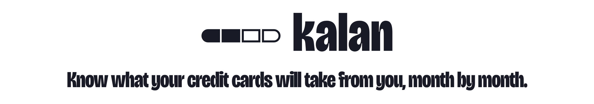
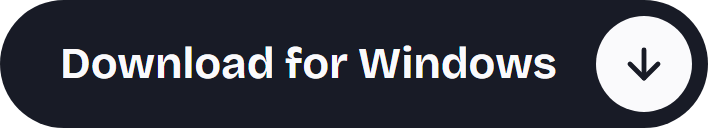
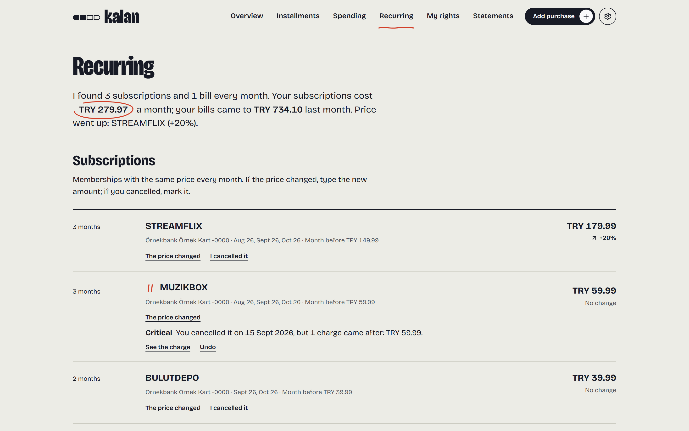

<p align="center">
  <picture>
    <source media="(prefers-color-scheme: dark)" srcset="docs/brand/header-dark.png">
    
  </picture>
</p>

<p align="center">
  <a href="https://github.com/Keremavsr/kalan-front/releases/latest"></a>
  
  <a href="LICENSE"></a>
</p>

<p align="center">
  <a href="https://github.com/Keremavsr/kalan-front/releases/latest">
    <picture>
      <source media="(prefers-color-scheme: dark)" srcset="docs/brand/download-dark.png">
      
    </picture>
  </a>
  <br>
  <sub>Free. No account, no server, no subscription.</sub>
</p>


kalan is a free, open source desktop app that reads your credit card statement PDFs and shows, in plain words:

1. how much you pay on each card this month, and by when,
2. how much installment (taksit) debt is left and when it ends,
3. where your money goes, and where you can save.

It runs on your own computer. If you already use an AI tool such as Claude Code, Codex, Gemini CLI or Antigravity,
kalan can use it to sort your spending into categories and suggest savings. It works without one too.

## What it does

- **Reads statements by itself.** Drop a PDF; kalan reads every row and checks its sum against the totals printed on the
  statement. Garanti BBVA Bonus, Yapı Kredi World and VakıfBank Worldcard are supported today; other banks can be added
  with a short template file, no code ([how](https://github.com/Keremavsr/kalan-back/blob/main/docs/adding-a-bank.md)).
- **Installments first.** Every plan, what is paid, what is left, the month each one ends. "What if I buy this in
  6 installments?" shows the new load on top of the current one before you buy.
- **Subscriptions and bills apart.** Fixed-price subscriptions, bills that change every month, and places you simply
  visit often are listed separately; price rises and charges after you cancelled are flagged.
- **Your rights.** Turkish card rules are built in: a letter to ask for the annual card fee back, and the minimum
  payment and interest at the legal rates.
- **Four languages:** Turkish, English, Spanish, Portuguese.

| | |
| --- | --- |
|  |  |

## Install

Download `kalan-setup-<version>.exe` from the [latest release](https://github.com/Keremavsr/kalan-front/releases/latest)
and run it. The app is not code-signed yet, so Windows SmartScreen asks once before it starts (More info, then Run
anyway). macOS and Linux builds are configured but not published yet.

## Privacy

Statements are read on your computer. kalan removes your card number, name, address and similar details before anything
is stored, and keeps the data in one file in your user folder. If you connect an AI tool, the transactions it sorts
(date, description, amount) are sent to that tool, and kalan tells you so in the app. The full rules are in the
[back end README](https://github.com/Keremavsr/kalan-back#privacy).

## Help kalan

Two things help most: a template for your bank and a translation. Both are explained in
[CONTRIBUTING.md](CONTRIBUTING.md). Something broken? [Open an issue](https://github.com/Keremavsr/kalan-front/issues/new/choose).
Security problems go through [SECURITY.md](SECURITY.md), not a public issue.

## How it is built

This repository is the app: the interface (Vite, React, TypeScript) and the desktop shell (Electron). The engine that
reads statements and does every calculation is [kalan-back](https://github.com/Keremavsr/kalan-back) (Python); the
two talk over HTTP on `127.0.0.1` only. The installer bundles both.

```sh
npm ci
npm run dev:mock           # demo data in the browser, no back end needed
npm run desktop:dev:mock   # the same in the desktop window
npm run lint && npm run typecheck && npm test && npm run build
```

Building the installer, the desktop shell, the screenshot scripts and the code layout are described in
[docs/development.md](docs/development.md).

## Licence

The code is MIT (see `LICENSE`).

The kalan name and logo are not licensed under MIT. Forks and redistributions under a different maintainer must use
a different name and logo. Bricolage Grotesque is under the SIL Open Font License 1.1 (`src/assets/fonts/OFL.txt`).
See `NOTICE`.
